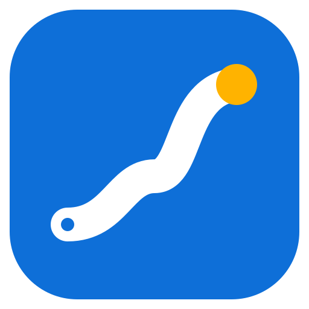
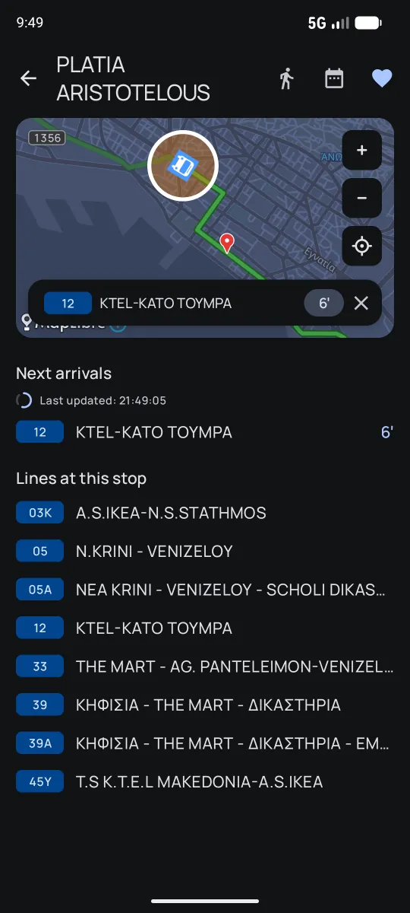
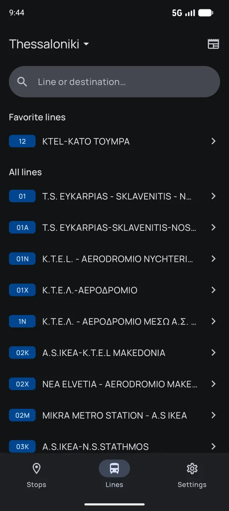
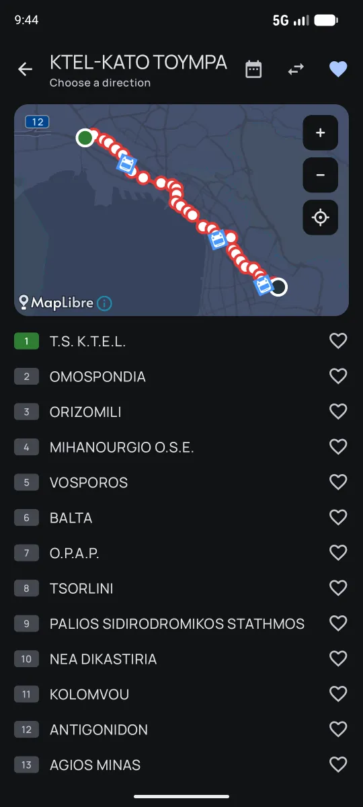
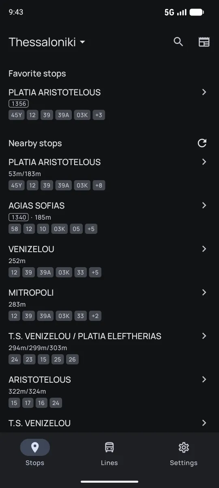
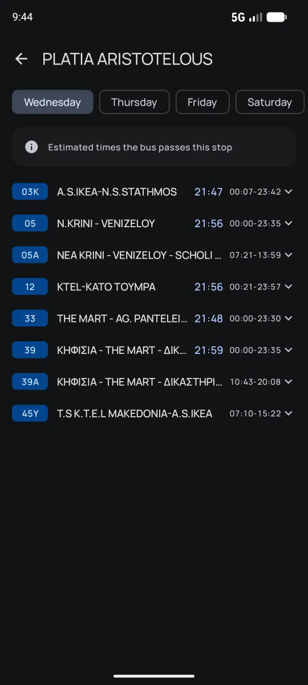

<h1 align="center">Astiko</h1>

<b>Live arrivals, full-day timetables and live bus maps for 26 Greek cities.</b>

## Screenshots

## Features

- Nearby stops from GPS, with favorites
- Arrival countdowns with live bus positions on the map
- Line browser: search, direction picker, stops in order, arrivals per stop
- Day-of-week timetables with the next departure highlighted
- Live line map: the route, its stops and buses in transit (MapLibre + OpenFreeMap)
- Offline cache with per-city prefetch and timetable fallback for arrivals

## Data sources

| Source | Cities | Data |
|---|---|---|
| `telematics.oasa.gr` | Athens | stops, arrivals, live vehicles, route geometry |
| `oseth.com.gr` | Thessaloniki | routes, timetables, arrivals, vehicles, geometry |
| `rest.citybus.gr` | 24 cities | stops, arrivals, lines, timetables, geometry |
| `data.gov.gr` | Thessaloniki | stop catalog (GTFS) |

The telematics APIs are unofficial.

## Contributing

Bug reports and pull requests are welcome.

## License

Released under the MIT License. See [LICENSE](LICENSE).
